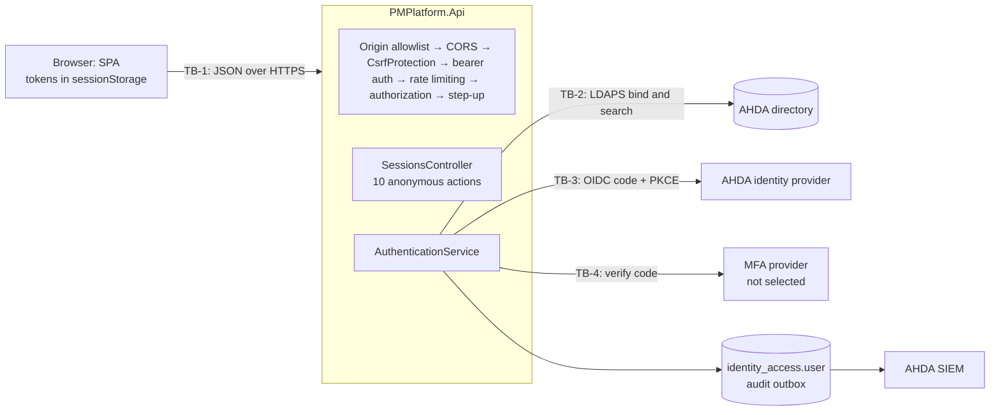

# Threat Model — Authentication and SSO

| Field | Value |
| --- | --- |
| Feature | Password sign-in against AHDA's directory (LDAP bind), SSO (OIDC), the platform's session tokens (access, refresh, MFA), the second factor and step-up, sign-in throttling, authentication audit, and the SPA's handling of the session |
| Built by | TASK-028 (PR #32), TASK-029 (PR #33), TASK-033 (PR #38), TASK-077 (PR #87), TASK-078 (PR #88), TASK-079 (PR #89) |
| Reviewed | `dev` at `6f19809`, 2026-10-16 |
| Feature records | `sso-directory-integration.md`, `mfa-privileged-access.md`, `auth-access-audit-logging.md`, `endpoint-hardening.md`, `csrf-protection.md` |
| Spec | FG-03 §7 (sessions), §11, §22, §24; Cybersecurity Guide Appendix A (CS-011, CS-021, CS-025, CS-028) |
| Out of scope here | Nafath (`threat-model-nafath.md`); authorization after sign-in (`threat-model-authorization.md`) |

Paths are under `src/backend/` unless they start with `src/frontend/` or `infra/`.

## 1. Data flow and trust boundaries

| Boundary | What crosses it | Trust |
| --- | --- | --- |
| TB-1 | Username and password, OIDC code, state and sealed transaction, MFA code, refresh token; tokens back | Untrusted: anyone on the internet reaches the anonymous endpoints |
| TB-2 | A search by an escaped username, then a bind as the found DN | The directory is trusted for authentication and for department, manager and job title only (ADR-007) |
| TB-3 | Authorization request; code redemption over the back channel; signed ID token | Trusted for signed assertions after issuer, audience, signature, lifetime and nonce checks |
| TB-4 | The platform user id and the code | Trusted for the verdict; attempt limiting is the provider's |

Sessions are stateless (`sso-directory-integration.md` D-3): an HS256 access token (15 min), a refresh token carrying the idle (30 min) and absolute (8 h) limits, both signed with `JWT_SIGNING_KEY`. Every refresh re-reads the user's status and assignments.

**Anonymous endpoints.** These are the 10 `[AllowAnonymous]` actions of `SessionsController` (lines 33, 50, 64, 81, 98, 118, 138, 184, 204, 221), plus `/health` (`PMPlatform.Api/Program.cs:177`) and OpenAPI in Development only (`Program.cs:160-163`). Since TASK-090 an eleventh anonymous action exists outside `SessionsController`: `POST /api/v1/client-error-reports` (`ClientErrorReportsController`), the SPA's error report, which verifies no credential and stores nothing (AUTH-T27). Every other endpoint must declare its protection, or the API does not start (`PMPlatform.Api/Authorization/EndpointAuthorization.cs:13-30`). Each anonymous action requires its own credential (a password, a code with its transaction, an MFA token or a refresh token), takes a JSON body, and is rate-limited (`RateLimitingTests.EveryAnonymousActionAndEverySensitiveWriteIsRateLimited`).

## 2. Threats

| ID | STRIDE | Threat | L | I | Inherent | Control and evidence | Residual | Status | Finding |
| --- | --- | --- | --- | --- | --- | --- | --- | --- | --- |
| AUTH-T01 | S | An anonymous caller injects LDAP filter syntax into the username (`*`, `x)(uid=*`) to match or bind as another directory entry | 3 | 3 | Critical | RFC 4515 escaping of every special, control and non-ASCII byte (`Infrastructure/Identity/LdapFilter.cs:15-34`), used for the sign-in search (`LdapDirectoryService.cs:46-47`); exactly one match, no referrals (`:184-197`); the bind is to the found DN (`:55`). `LdapFilterTests.AUsernameIsOneEscapedAssertionValue`; `DirectorySignInTests.EveryRejectedSignInIsTheSameGeneric401` | Low | MITIGATED | SR-01 |
| AUTH-T02 | S | An empty password turns the user bind into an unauthenticated bind, which most directories accept | 3 | 3 | Critical | Refused at the request shape (`RequestValidation.cs:12-21`), in the service (`AuthenticationService.cs:50-56`) and in the adapter (`LdapDirectoryService.cs:37-41`). `DirectorySignInTests.AnEmptyPasswordIsAShapeErrorAndNeverReachesTheDirectory` | Low | MITIGATED | SR-01 |
| AUTH-T03 | S | Password guessing or spraying against `POST /sessions` from many addresses yields a session for any user whose roles need no MFA | 3 | 2 | High | `SignIn` limit of 30 a minute per client address (`PMPlatform.Api/Middleware/RateLimiting.cs:23-46`), with the address taken from trusted forwarded hops only (`Program.cs:99-106`); a 1 s floor on every rejection (`AuthenticationService.cs:433-450`); every failure audited with the typed name and forwarded to the SIEM. `RateLimitingTests.ASignInBurstBeyondTheLimitIsThrottledWith429AndRetryAfter`, `.ASpoofedForwardedForDoesNotEscapeTheLimit`; `SiemForwardingTests.AFailedSignInReachesTheSiem`. Remaining: the limit is per address, not per account; no Redis is provisioned, so each instance counts alone; the store fails open | Medium | PARTIAL | SR-06 |
| AUTH-T04 | D | An anonymous attacker locks named AD accounts by failing their password on purpose, denying them every AHDA system | 3 | 1 | Medium | The per-address limit only; the platform cannot see AD's lockout reason (`LdapDirectoryService.cs:57-61`) | Medium | DEPENDS | SR-07 |
| AUTH-T05 | I | Status, body or timing reveals whether a username exists, has an account, is disabled or belongs to a suspended entity | 3 | 1 | Medium | One 401 `AUTHENTICATION_REQUIRED` for every cause (`SessionsController.cs:266-269`) after the 1 s floor; the bearer 401 is identical whatever the token fault (`BearerChallenge.cs:17-23`). `DirectorySignInTests.EveryRejectedSignInIsTheSameGeneric401` | Low | MITIGATED | — |
| AUTH-T06 | I | A network attacker between the API and the directory reads passwords over plain LDAP or impersonates the domain controller | 2 | 3 | High | `ldaps://` required unless `AllowUnencryptedConnection`, which only the compose file sets (`LdapDirectoryService.cs:141-144`); TLS through `UseSsl()` with the library's default handler, which rejects any certificate error (`:150-153`). `ProviderUnavailableTests.AnUnencryptedDirectoryIsRefusedUnlessAllowed`. Not tested: refusal of an untrusted certificate | Low | MITIGATED | SR-03 |
| AUTH-T07 | S | An attacker forges or replays the OIDC authorization response (CSRF on the redirect, code injection, ID-token replay) to sign in as someone else | 3 | 3 | Critical | Random `state`, `nonce` and PKCE S256 (`OpenIdConnectRelyingParty.cs:49-61`); the transaction sealed with AES-256-GCM under a per-flow key (`AuthorizationTransactionProtector.cs:27-61`); expiry and a constant-time state check (`OpenIdConnectRelyingParty.cs:78-86`); nonce (`:115-119`); `redirect_uri` from configuration only. `SingleSignOnTests.ATamperedTransactionIsRejected`, `.AStateThatIsNotTheTransactionsIsRejected`, `.ACodeCanBeRedeemedOnlyOnce`, `.AnIdTokenForAnotherSignInIsRejected`, `.AnExpiredTransactionIsRejected` | Low | MITIGATED | SR-02 |
| AUTH-T08 | S | An ID token from the wrong issuer or audience, signed by a foreign key, or algorithm-confused, is accepted | 2 | 3 | High | `ValidIssuer` is the metadata issuer, which must equal the configured authority; `ValidAudience` is the client id; JWKS keys only, signed tokens required (`OpenIdConnectRelyingParty.cs:160-166`, `:233-248`, `:269-270`). Not present: a `ValidAlgorithms` pin, and negative tests for issuer, audience, signature and expiry (only the nonce case is tested) | Low | PARTIAL | SR-08 |
| AUTH-T09 | S | The SSO subject claim is mutable or is not the directory's immutable id (e.g. `email`, or Entra `oid` against `objectGUID`), so an IdP identity maps to another platform user | 2 | 3 | High | Exact match of `Identity:Sso:SubjectClaim` to `User.DirectorySubjectId` (`OpenIdConnectProvider.cs:71-74`, `AuthenticationService.cs:233`); no group or role claim is read. Which claim AHDA's IdP issues is `sso-directory-integration.md` F-2 | Medium | DEPENDS | SR-09 |
| AUTH-T10 | S | Login CSRF on the SSO callback: the victim's browser completes the attacker's code, state and transaction and is signed in as the attacker | 2 | 2 | Medium | The SSO transaction is not bound to a browser (`OpenIdConnectProvider.cs:52`); a cross-site post of it is refused (JSON only, origin allowlist). The SPA has no `/auth/callback` route yet; when built, it must take the transaction only from `sessionStorage` | Medium | DEPENDS | SR-17 |
| AUTH-T11 | S | A caller forges or confuses a platform token: `alg:none` or another algorithm, an MFA or refresh token presented as an access token, an expired token, a token from another environment | 3 | 3 | Critical | Fixed issuer, one audience per token kind, `ValidAlgorithms = [HS256]`, signed and expiring tokens, zero clock skew (`Infrastructure/Identity/SessionTokenValidation.cs:19-35`); a distinct key per environment (`infra/environments/environments.json`). `SessionLifetimeTests.AnAccessTokenAndARefreshTokenCannotStandInForEachOther`, `.AnAccessTokenIsRefusedOnceItExpires`, `.ATokenIsRejectedOnceTheSigningKeyIsRotated` | Low | MITIGATED | SR-02 |
| AUTH-T12 | E | Disclosure of `JWT_SIGNING_KEY` lets an attacker mint any session (R01, MFA, a fresh `auth_time`) and open SSO and Nafath transactions, which derive their keys from it | 1 | 3 | Medium | Secret store mandatory outside Development (`Program.cs:44-46`); at least 32 bytes (`SessionSigningKey.cs:14-28`); read per use, so a rotation applies at once. `ATokenIsRejectedOnceTheSigningKeyIsRotated` | Medium | DEPENDS | SR-18 |
| AUTH-T13 | S | A stolen refresh token keeps a session alive until its 8 h absolute limit: a used refresh token stays valid, reuse is not detected, and sign-out only clears the browser tab | 2 | 3 | High | Lifetimes 15 min / 30 min / 8 h carried in the signed token (`SessionTokenOptions.cs:12-18`); status and assignments re-read on every refresh (`AuthenticationService.cs:86-111`). `SessionLifetimeTests.NoRefreshOutlivesTheAbsoluteSessionLifetime`, `.ARefreshIsRefusedOnceTheUserIsDisabled`. No rotation, reuse detection or server-side sign-out: `ReadRefreshTokenAsync` checks the signature only (`JwtSessionTokenService.cs:68-80`); `signOut` clears `sessionStorage` only (`src/frontend/src/shared/api/sessionStore.ts:68-73`) | Medium | GAP | SR-10 |
| AUTH-T14 | I | Script injected into the SPA's origin reads both tokens from `sessionStorage` and replays them from anywhere | 2 | 3 | High | No token in a cookie or URL; deny-all CSP on API responses; the SPA's sink lint and `isAppPath` (TASK-077). `SecurityHeadersTests.EveryKindOfResponseCarriesEveryHeader`; `CsrfProtectionTests.TheSessionIsNeverACookie`. The SPA's own CSP depends on how its bundle will be served (`endpoint-hardening.md` F-3) | Medium | PARTIAL | SR-11 |
| AUTH-T15 | E | A person who requires MFA gets or keeps a session without it: through SSO, a refresh, Nafath, a role gained mid-session, or a token minted before the policy grew | 2 | 3 | High | Every new session passes the MFA gate (`AuthenticationService.cs:253-275`); a refresh refuses a non-MFA continuation for a user who now needs MFA (`:96-101`); the bearer refuses a non-MFA token holding an MFA role (`PMPlatform.Api/Authorization/MultiFactorTokenValidation.cs:14-33`); the engine re-checks MFA against roles held now (`PermissionAuthorizationHandler.cs:26-32`). `MultiFactorBypassTests.NoEndpointIssuesASessionOrServesAPersonWhoHasNotPassedTheSecondFactor`, `.ARefreshTokenThatSkippedMfaIsNotRefreshed`, `.ARoleThatRequiresMfaIsNotHandedOverByARefresh`; `AuthorizationEndpointTests.R01GainedMidSessionGrantsNothingWithoutMfa` | Low | MITIGATED | SR-04 |
| AUTH-T16 | S | Holding a valid MFA token (a correct password), an attacker guesses the code, starting new challenges for 5 minutes, or completes the sign-in with another person's challenge | 2 | 3 | High | A 1 s floor on MFA and step-up completion; the shared `SignIn` limit; the MFA token lives 5 min; the platform user id is sent with every verify (`HttpMultiFactorProvider.cs:84`); only an explicit `verified: true` passes (`:89-91`). `MultiFactorBypassTests.AWrongCodeIsTheGeneric401AndSpendsTheChallenge`, `.AnotherPersonsChallengeDoesNotCompleteASignIn`, `.AnMfaTokenExpiresAfterFiveMinutes`. The per-user attempt limit and the challenge-to-user binding are the provider's, and no provider is selected (`mfa-privileged-access.md` F-1, F-4) | Medium | DEPENDS | SR-12 |
| AUTH-T17 | S | Someone holding the password of an R01 who has not enrolled a second factor enrols their own at sign-in and owns that administrator account | 2 | 3 | High | `Identity:Mfa:AllowEnrolmentAtSignIn` (`Application/Features/IdentityAccess/Contracts/MultiFactorPolicy.cs:21-25`) is true by default and no environment overrides it; the enrolment is audited. `MultiFactorSignInTests.WithoutEnrolmentAtSignInAnUnenrolledAdministratorIsRefused` proves the switch works. Recorded as `mfa-privileged-access.md` F-2 | High | DEPENDS | SR-13 |
| AUTH-T18 | S | Whoever holds an unenrolled user's refresh token (no password needed) enrols their own factor through step-up; the victim is then challenged by the attacker's factor at every sign-in, and nothing in the platform can reset it | 2 | 2 | Medium | None: `BeginStepUpAsync`/`CompleteStepUpAsync` take only the refresh token (`AuthenticationService.cs:139-169`), and `PurposeFor` answers Enrolment for an unenrolled user (`:408-411`). The only writer of `mfa_enrolled_at` is `UserAccessRepository.cs:92`. `StepUpTests.AStepUpOperationNeedsASecondFactorFromEveryUser` walks this path and resets the enrolment by SQL | Medium | GAP | SR-16 |
| AUTH-T19 | E | A privileged action is taken on a stale or stolen session without a fresh second factor | 2 | 3 | High | `StepUpAuthentication.cs:19-53` (MFA and `auth_time` within 5 min, refusal audited), seven operations listed (`PMPlatform.Api/appsettings.json:33-42`), an unknown name stops start-up; a refresh never renews `auth_time`. `StepUpTests.APrivilegedActionWithAStaleSessionRequiresReauthentication`, `.ARefreshDoesNotMakeAStaleSessionFresh`. Not on the list: `IdentityAccess_UpdateRole`, `_CreateUser`, `_UpdateUser`, the three external-entity status operations, enabling and disabling an integration, rebuilding the Activity projection | Medium | PARTIAL | SR-14 |
| AUTH-T20 | E | A disabled user, or a user of a suspended entity, keeps using `[AllowAnyAuthenticatedUser]` endpoints (notifications, preferences, report jobs, `GET /sessions/current`) until the access token expires | 2 | 2 | Medium | `UserAccess.MaySignIn` on every sign-in, MFA, refresh and step-up path; the engine refuses an inactive principal on every `[RequirePermission]` request (`AuthorizationEngine.cs:61-62`). `ADisabledUsersTokenGrantsNothingFromTheNextRequest`. Own records only, for at most 15 minutes | Low | PARTIAL | SR-19 |
| AUTH-T21 | R | An authentication outcome is not recorded, or recorded without its cause, so a brute force or takeover cannot be investigated | 2 | 2 | Medium | Every attempt audited before the answer (`AuthenticationService.cs:453-503`); rejected bearer tokens audited; the AUTHENTICATION class forwarded, and a subset without it stops start-up. `AuditTrailTests.EveryFailedAuthenticationProducesOneAuditEvent`; `SiemForwardingTests.ASubsetWithoutAuthenticationStopsStartUp`. Throttled attempts are logged, not audited (`endpoint-hardening.md` F-6); the SIEM is not named (`auth-access-audit-logging.md` F-1) | Low | PARTIAL | SR-20 |
| AUTH-T22 | I | Passwords, tokens, codes or directory internals leak through logs, error bodies, caches or URLs | 2 | 3 | High | Credentials only in JSON bodies and `Authorization`; token responses `no-store` (`SessionsController.cs:299-304`); bearer errors without detail (`Program.cs:74`); a sanitised 500; directory messages not logged; secret-bearing records redact `ToString`. `CredentialLoggingTests.NoCredentialOrTokenAppearsInTheLogs` | Low | MITIGATED | SR-05 |
| AUTH-T23 | T | Another site makes the victim's browser call a session endpoint: login CSRF on `/sessions`, a forged refresh or step-up | 3 | 2 | High | `CsrfProtection.cs:38-54`; the origin allowlist (`OriginAllowlist.cs:30-39`); CORS without credentials; no cookie. `CsrfProtectionTests.EveryStateChangingEndpointRefusesAForgedRequest`, `.TheSessionIsNeverACookie`; `OriginAllowlistTests.ARequestFromAnOriginNotListedIsNotExecuted` | Low | MITIGATED | SR-05 |
| AUTH-T24 | S | After sign-in the SPA follows an attacker-supplied return path to another origin | 3 | 1 | Medium | The return path comes from router state and is followed only if `isAppPath` (`src/frontend/src/features/identity-access/session/SignInPage.tsx:26-29`). `appPath.test.ts` | Low | MITIGATED | — |
| AUTH-T25 | T | A `challengeId` of `.` or `..` survives URL escaping and, by dot-segment removal, sends the verify call to another provider path | 2 | 1 | Low | Escaping only (`HttpMultiFactorProvider.cs:82-83`); the field is checked for length only | Low | GAP | SR-21 |
| AUTH-T26 | S | The platform counts the IdP's `amr` as the second factor, or measures step-up freshness from an old IdP `auth_time`, when the IdP did not apply MFA | 2 | 3 | High | `IdentityProviderMethods` empty by default (`MultiFactorPolicy.cs:27-32`); counted only with `auth_time`, capped at now (`AuthenticationService.cs:421-431`). `MultiFactorSignInTests.AnIdentityProviderSecondFactorCountsOnlyWhenTheConfigurationTrustsIt`. Which `amr` values to trust is AHDA's | Low | DEPENDS | SR-15 |
| AUTH-T27 | D | An anonymous caller floods `POST /client-error-reports`, or fills it with invented or abusive text, burying real errors in the APM and running up its ingest | 3 | 1 | Medium | Rate-limited per client address (`ClientErrorReport`, 30 a minute; `RateLimitingTests.EveryAnonymousActionAndEverySensitiveWriteIsRateLimited`); bounded fields and a path without query (`ClientErrorReportCreateRequest.Validate`; `ApmErrorTrackingTests.AnIncompleteReportIsRefused`); JSON body, so `CsrfProtection` and the origin allowlist apply; nothing stored, no state changed; each event tagged `origin=spa`, so the APM separates reports from server errors; redacted like every event (`ApmRedactionTests.NoRegisteredFieldReachesTheApm`) | Low | MITIGATED | — |

Counts by inherent rating: Critical 4, High 13, Medium 8, Low 1.

## 3. Spec controls against evidence

| Control | Evidence | Gap |
| --- | --- | --- |
| CS-011 centralised enterprise authentication; no unmanaged local accounts | Directory bind and OIDC only; no password is stored by the platform | — |
| CS-011 lockout and session controls aligned to AHDA's standard | Lifetimes provisional (`sso-directory-integration.md` F-1); lockout is AD's (AUTH-T04) | AHDA IT confirms (SR-07) |
| CS-011/028 MFA for privileged accounts | R01 needs MFA on every path (AUTH-T15) | Provider not selected (SR-12); enrolment at sign-in (SR-13) |
| FG-03 §7.4 invalidate or expire sessions where supported | Expiry only | No revocation (SR-10) |
| CS-025 authentication and authorization failures logged and forwarded | AUTH-T21 | SIEM not named |
| CS-028 OWASP protections: injection, CSRF | AUTH-T01, AUTH-T23 | — |
| REV-IAM-003, authentication side | Every endpoint declares its protection; 10 anonymous actions, each correct, and since TASK-090 the SPA's error report (AUTH-T27) | — |

## 4. Record claims found stale

| Record | Claim | On `dev` |
| --- | --- | --- |
| `mfa-privileged-access.md` F-3, D-5 | One step-up operation ships | Seven (`appsettings.json:33-42`) |
| `sso-directory-integration.md` F-12 | The SPA has no sign-in screen or callback | The password and MFA screens exist; the SSO start and `/auth/callback` route do not |
| `sso-directory-integration.md` F-3 | A stolen refresh token works until its idle timeout | Chained refreshes keep it alive to the 8 h absolute limit (AUTH-T13) |
| `mfa-privileged-access.md` F-2 | Enrolment rests on the first factor at sign-in | Also on the refresh token alone, through step-up (AUTH-T18) |

## 5. Change log

| Date | Change |
| --- | --- |
| 2026-10-16 | First review (TASK-081) |
