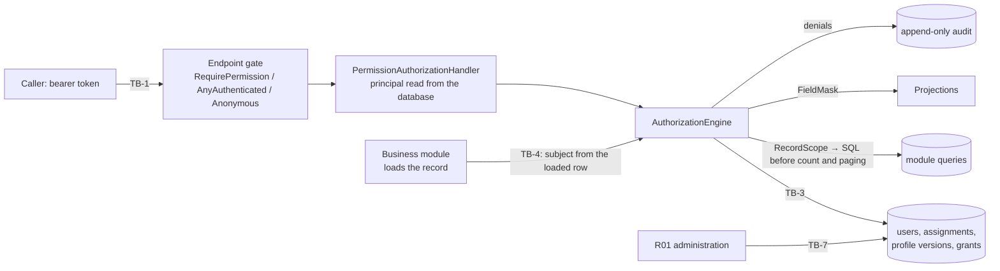

# Threat Model — RBAC and Data-Scope Authorization Engine

| Field | Value |
| --- | --- |
| Feature | The endpoint gate, the authorization engine (permission, scope, relationship, classification, record state, workflow actor), record scopes for collections, field masking, and the FG-03 administration that feeds them (users, assignments, profiles, master data and configuration) |
| Built by | TASK-030 (PR #34), TASK-031 (PR #35), TASK-033 (PR #38, denial audit), TASK-037 (PR #42, record scopes); each business module's record check in its own task |
| Reviewed | `dev` at `6f19809`, 2026-10-16, including a sweep of every controller's by-id and collection endpoints (§3) |
| Feature records | `authorization-engine.md`, `identity-access-administration.md` |
| Spec | FG-03 §11 (backend authorization, query security, record state), §22, §24 (REV-IAM-001 to -009); Blueprint Appendix A (indicative matrix); CS-011 |

Paths are under `src/backend/` unless stated.

## 1. Data flow and trust boundaries

1. **The gate** (TB-2). Every endpoint declares `[RequirePermission]`, `[AllowAnyAuthenticatedUser]` or `[AllowAnonymous]`; the API refuses to start otherwise (`PMPlatform.Api/Authorization/EndpointAuthorization.cs:13-30`). The fallback policy is "authenticated" (`Program.cs:78-79`).
2. **The principal** (TB-3) is read from the database on every request. The user must be ACTIVE and not a service principal; an external user's entity must be ACTIVE. A grant comes from an assignment that is ACTIVE, has started and not ended, is bound to a PUBLISHED profile version, and for an external user carries an external-eligible role (`Infrastructure/Persistence/Authorization/AuthorizationRepository.cs:15-63`). Nothing is cached across requests.
3. **The record decision** (TB-4). The module loads the record and builds the subject from it, and the engine decides in order: granted, covers (project, entity isolation, scope), clears (classification rank), read-only, record state, workflow actor (`Application/Common/Authorization/AuthorizationEngine.cs:187-216`). A record no same-group grant covers is 404, otherwise 403 (`:204-209`). Denials go to the append-only audit store (`:41-46`).
4. **Collections** (TB-5). `GetRecordScopeAsync` becomes a SQL predicate applied before counting and paging (`:68-82`).
5. **Masking** (TB-6). `GetFieldMaskAsync` (`:151-177`) reads the FIELD_CLASSIFICATION version in force; ranks are DATA_CLASSIFICATION `sort_order`.
6. **Administration** (TB-7). R01 holds the administration permissions at ALL and no business permission (`PermissionCatalogue.cs:548-639`). Profile versions cannot be authored through the API (TASK-110).
7. **Directory** (TB-8). A sign-in maps the directory or IdP subject to a user by `directory_subject_id`; no role or group is read from the IdP.

## 2. Threats

| ID | STRIDE | Threat | L | I | Inherent | Control and evidence | Residual | Status | Finding |
| --- | --- | --- | --- | --- | --- | --- | --- | --- | --- |
| RBAC-T01 | E | An endpoint ships with no authorization declaration and is reachable by any authenticated caller | 2 | 3 | High | Start-up refusal of an undeclared endpoint or an unknown permission (`EndpointAuthorization.cs:13-30`); fallback authenticated policy. `AuthorizationEndpointTests.EveryEndpointDeclaresItsServerSideProtection`; `AdministrationEndpointTests.EveryAdministrationEndpointNamesItsPermission` | Low | MITIGATED | SR-22 |
| RBAC-T02 | E | IDOR: a user holding a permission at a narrow scope acts on a record by id outside it | 2 | 3 | High | Every by-id endpoint loads the record and authorizes on the loaded row's anchors (the sweep in §3 found no exception across all controllers), e.g. `Application/Features/Risk/RiskAccess.cs:21-28`, `IdentityAccess/Administration/UserAdministrationService.cs:199-203`, `DocumentManagement/DocumentService.cs:305-319`. `EffectiveAuthorizationTests.AMissingPermissionIs403OnAVisibleRecordAnd404OnAnInvisibleOne`; `ShippedGrantTests.AGrantedCellDeniesOutsideItsScope`; module suites. Nothing structural forces the next module to do the same | Medium | MITIGATED | SR-23 |
| RBAC-T03 | I | A collection, count or page leaks out-of-scope rows | 2 | 3 | High | Scope as SQL before `Count` and paging (e.g. `Infrastructure/Persistence/Project/ProjectRepository.cs:36,64`, `DocumentRepository.cs:54`, `AuditReadRepository.cs:28-36`); report jobs, saved views and notifications filter by owner or recipient in SQL; dashboards and reports read only the caller's reached projects. `RecordScopeTests.TheScopeMatchesExactlyTheRecordsTheEngineAllows` (8,000 random cases) | Low | MITIGATED | SR-23 |
| RBAC-T04 | I | An external user enumerates another entity's records by id, using a 403-versus-404 difference | 3 | 3 | Critical | Absolute entity isolation for external principals (`AuthorizationEngine.cs:230-234`); R-47 404 (`:204-209`); external users limited to external-eligible roles (`AuthorizationRepository.cs:55`). `EffectiveAuthorizationTests.NoScopeTakesAnExternalUserOutsideTheirEntity`; `EntityIsolationTests.AnEntityUserCannotReachAnotherEntitysRequestsOrContributionsByAnyCall` | Low | MITIGATED | SR-24 |
| RBAC-T05 | E | ALL scope bypasses classification, record state or the workflow actor (REV-IAM-004) | 2 | 3 | High | ALL answers only "covers"; clearance, read-only, state and actor still apply (`AuthorizationEngine.cs:191-215`). `EffectiveAuthorizationTests.ALockedRecordCanBeReadButNotChanged`, `.AWorkflowStepIsActedOnOnlyByItsActors`, `.ARecordIsVisibleOnlyUpToThePermissionsClearance` | Low | MITIGATED | SR-25 |
| RBAC-T06 | E | R01 acts on business records, approves, or changes a closed record (REV-IAM-002) | 1 | 3 | Medium | No business grant to R01 (`PermissionCatalogue.cs:548-639`); `ClosedProjectGuard` refuses writes to a CLOSED project whatever the permission. `ShippedGrantTests.AWithheldCellIsDenied`. RBAC-T07 gets round it | Medium | PARTIAL | SR-27 |
| RBAC-T07 | S | An R01 re-points a user's `directory_subject_id` to a directory account they control and signs in as that user, approver included, with no second factor if the victim's roles need none; every later action is attributed to the victim | 1 | 3 | Medium | Only the audited `UserUpdated` event with old and new values. `UpdateAsync` writes `DirectorySubjectId` from the request with no rule (`UserAdministrationService.cs:147`), though the job title has one (`:120`); `CheckWritableAsync` refuses only service principals (`:199-203`); sign-in matches on that field (`UserAccessRepository.cs:20-21`); `UpdateUser` is not a step-up operation. No test | Medium | GAP | SR-27 |
| RBAC-T08 | E | An administrator gives themselves a role, or two administrators trade roles, with no recorded reason or second approval | 1 | 3 | Medium | Self-assignment and self-ending refused (`AccessRelationshipService.cs:76-80`, `:193-196`); step-up on assignment create and end. `AccessRelationshipServiceTests.NoAdministratorAssignsThemselvesAndNoServicePrincipalIsAssigned`. Two colluding R01s, or RBAC-T07, defeat it; FG-03 §10.1 asks for a reason on privileged assignment | Medium | PARTIAL | SR-29 |
| RBAC-T09 | E | A profile author publishes their own grants | 1 | 3 | Medium | No API authors or publishes a profile version (`PermissionProfilesController.cs` is read-only); a DRAFT grants nothing (`AuthorizationRepository.cs:54`); `GovernedLifecycle` separation of duties is ready for TASK-110 | Low | MITIGATED | — |
| RBAC-T10 | T | One administrator neutralises masking alone: re-ranks a PUBLISHED DATA_CLASSIFICATION item's `sort_order`, or retires the FIELD_CLASSIFICATION version in force, which unmasks every field (masking fails open). Both bypass the three-person rule that guards publishing | 1 | 3 | Medium | Audited only. `MasterDataAdministrationService.cs:155` accepts the edit on a PUBLISHED item; `ConfigurationAdministrationService.cs:211-238` retires with no separation of duties; no version in force means no rules (`AuthorizationRepository.cs:80-97`, `AuthorizationEngine.cs:161-164`). Latent while no classification is published (RBAC-T22) | Medium | GAP | SR-28 |
| RBAC-T11 | I | An R08 assignment without a project reaches every project of the user's entity, not only the projects it was granted for (BR-IAM-013, REV-IAM-006) | 1 | 2 | Low | A project is required only for R04 (`AccessRelationshipService.cs:294`); a per-project assignment is refused for a project the entity does not deliver (`:295`), so the multi-entity case can only be served entity-wide | Low | PARTIAL | SR-30 |
| RBAC-T12 | E | A revoked, disabled or ended grant is still honoured from a token or a cache | 2 | 3 | High | Status and grants read on every request; the handler ignores the token's roles (`PermissionAuthorizationHandler.cs:26-35`). `AuthorizationEndpointTests.AnEndedAssignmentTakesEffectOnTheNextRequest`; `AdministrationEndpointTests.ADisabledUsersTokenGrantsNothingFromTheNextRequest` | Low | MITIGATED | SR-24 |
| RBAC-T13 | E | An assignment is honoured before its `starts_at` or after its `ends_at` (REV-IAM-008) | 2 | 2 | Medium | Dates evaluated per request (`AuthorizationRepository.cs:52-53`). No test has an ACTIVE assignment outside its window, and no expiry audit event is emitted (FG-03 §22.2) | Low | PARTIAL | SR-31 |
| RBAC-T14 | E | DEPT scope follows a department the user has left, because the directory's department is copied only at sign-in | 2 | 2 | Medium | Refreshed at each sign-in (`AuthenticationService.cs:243-246`); a session lasts at most 8 h; the TASK-075 reconciliation reports mismatches | Low | PARTIAL | SR-32 |
| RBAC-T15 | E | An external user is granted an internal-only role | 1 | 3 | Medium | Refused at assignment (`AccessRelationshipService.cs:290`) and ignored at evaluation (`AuthorizationRepository.cs:55`). `AccessRelationshipServiceTests` (external R01 refused); `TheEngineHoldsNoInternalOnlyRoleOfAnExternalUser` | Low | MITIGATED | — |
| RBAC-T16 | E | A service principal is used interactively or given a human role | 1 | 3 | Medium | Inactive in the engine (`AuthorizationRepository.cs:37`); not assignable (`AccessRelationshipService.cs:71-74`). `UserAdministrationServiceTests.AServicePrincipalIsNotAdministered` | Low | MITIGATED | — |
| RBAC-T17 | T | Mass assignment of scope fields (entity, department, project) in the assignment request | 2 | 3 | High | A fixed request record (`PMPlatform.Api/Models/IdentityAccess/AccessRelationshipCreateRequest.cs:7-15`); ROLE_ASSIGN decided on the resulting anchors; an external user's anchors forced to their own entity (`AccessRelationshipService.cs:58`, `:291-295`). `AdministrationContractTests.AnExternalGrantBreakingADR013IsRefusedWithEveryRuleItBreaks` | Low | MITIGATED | SR-24 |
| RBAC-T18 | T | A still-held grant writes to a CLOSED project's records | 2 | 2 | Medium | `ClosedProjectGuard`; closure ends the project's access (`CloseoutActivation.cs:85`). `ClosedProjectWriteTests` (every documented write); `AdministrationEndpointTests.ClosingAProjectEndsTheAccessItGave` | Low | MITIGATED | — |
| RBAC-T19 | R | An authorization denial leaves no record | 2 | 2 | Medium | Denials audited in the append-only store (`AuthorizationEngine.cs:41-46`). `AuthorizationAuditTests.ARefusalIsAuditedWithItsReasonAndTheRecordsAnchors`; `AuditTrailTests.APermissionRefusalIsAudited` | Low | MITIGATED | — |
| RBAC-T20 | D | An authenticated user floods the audit store with denials through reads, which are not rate-limited | 2 | 1 | Low | Rate limiting covers sign-in and sensitive writes only | Low | PARTIAL | SR-33 |
| RBAC-T21 | E | An approval is decided through a role the caller holds other than the stage's role | 2 | 3 | High | `AuthorizationRequest.RoleCode` restricts the decision to that role's grants (`AuthorizationEngine.cs:219-220`); `ApprovalAuthority` requires an active internal user who is not the requester. `EffectiveAuthorizationTests.ARoleRestrictedRequestCountsOnlyThatRolesGrants`; `ProjectLifecycleEndToEndTests.OnlyTheRoutedApproverDecidesTheReview` | Low | MITIGATED | SR-24 |
| RBAC-T22 | I | Fields AHDA means to restrict by audience (an entity's view of budget and expenditure, CTL-19, ADR-013) are shown in full, because no DATA_CLASSIFICATION item and no FIELD_CLASSIFICATION version exist yet, and with no version the mask reveals everything | 2 | 3 | High | The mechanism is built and tested (`AuthorizationEngine.cs:151-177`; `FieldMaskTests`, `FieldClassificationTests.AFieldAboveThePermissionsClearanceIsMaskedAndADraftClassificationIsNot`; `financial-kpi.md` D-12). The taxonomy is UGV-01, AHDA's; `financial-kpi.md` F-6 records that no field is masked | High | DEPENDS | SR-26 |
| RBAC-T23 | E | An engine or database failure grants access | 2 | 3 | High | Exceptions propagate and nothing succeeds by default; an unknown user is inactive; an unknown permission throws. `EffectiveAuthorizationTests.ADisabledOrUnknownUserHoldsNothing`, `.APermissionOutsideTheCatalogueIsAProgrammingError` | Low | MITIGATED | SR-22 |
| RBAC-T24 | E | A grant is revoked between the check and the write in the same request | 1 | 1 | Low | The principal is read once per request; writes use the row version | Low | MITIGATED | — |
| RBAC-T25 | E | A user holding PROJECT_REGISTER through a per-project or OWN grant moves a RETURNED project into a department where they hold no grant | 2 | 2 | Medium | The subject keeps the project id and owner, so the per-project or OWN grant covers the new department too (`Application/Features/Project/ProjectService.cs:112-116`, `ProjectAccess.cs:27-33`). External users stay pinned by isolation | Medium | GAP | SR-34 |
| RBAC-T26 | E | A holder of a RAISE permission on the project edits and submits a change, suspension or closeout request someone else raised; the run keeps the original requester, so the requester-is-not-approver rule excludes only them and the real author can approve their own text | 2 | 2 | Medium | None: no "caller is the requester" check (`ChangeRequestLifecycleService.cs:131`, `:163-165`; the same in Suspension and Closeout). With the shipped grants this needs a project-manager change or custom grants | Medium | GAP | SR-35 |
| RBAC-T27 | E | One person holding two stages' roles approves both stages of one approval run | 2 | 2 | Medium | None found in `ApprovalAuthority.ResolveAsync` or `ApprovalWorkflowService.DecideAsync`. Whether WF-11 requires distinct approvers across stages is to be confirmed | Medium | DEPENDS | SR-36 |
| RBAC-T28 | T | A KPI owner or a post-project obligation owner is set to any active user, including an external user of another entity | 2 | 1 | Low | None (`KpiAssignmentService.cs:62,109`; `PostProjectObligationService.cs:57,97`); the owner field grants no access | Low | GAP | SR-37 |
| RBAC-T29 | I | Small existence oracles: an upload naming another project answers 403 for an existing out-of-scope project and 422 for a missing one; a shared saved view returns the owner's project and department ids | 2 | 1 | Low | Ids are UUIDv7; running the view still refuses an out-of-scope narrowing (`SavedViewService.cs:176-178`) | Low | GAP | SR-37 |

Counts by inherent rating: Critical 1, High 9, Medium 14, Low 5.

## 3. Controller sweep

Every controller was swept for record-level authorization: the by-id actions, the collections and their counts. The result is no IDOR. Every by-id action loads the record and authorizes on the loaded row's anchors, and every collection filters in SQL before counting and paging.

| Group | Controllers | How the record is authorized |
| --- | --- | --- |
| Identity and access | Users, AccessRelationships, PermissionProfiles, Permissions, Roles, Departments, ExternalEntities | `AdministrationAccess` on the loaded user, department or entity; lists only to an anchor-less grant |
| Execution | Projects, ProjectTasks, TaskDependencies, ActivityExecutionProgresses, ProjectSchedules, ScheduleActivities, ScheduleDependencies, ScheduleHealthStatuses, ProjectBaselines, ProjectMilestones, MilestoneAchievements, Progress*, PublishedProgressSnapshots, ProjectHealthStatuses, ReportingCycles, Financial*, Kpi* | Load the record, then its project's facts, then `<Module>Access.CheckAsync`, then `ClosedProjectGuard`; child references bound to the same project under a lock |
| Risk, governance, WF-13, approvals | Risk*, ManagementConcerns, ConcernEscalations, ChangeRequests, ChangeAuthorizations, SuspensionRequests, ActiveSuspensions, ClosureCases, CompletionCases, ReadinessChecks, PostProjectObligations, ExternalUpdateRequests, ExternalContributions, SourceApplications, Approval* | As above; authority actions internal-only; approvals through `ApprovalAuthority` |
| Documents | Documents, EvidenceReferences | `DocumentService` on the loaded document; a version must belong to the route's document (`DocumentService.cs:309`) |
| Reporting and dashboards | Reports, ReportExplorer, ReportJobs, ReportDefinitions, SavedViews, Dashboards, DashboardDefinitions, DashboardProjections | Rows from the caller's reached projects only; report jobs and saved views by owner (or role share) in SQL; a download re-planned and re-run as the requester, with its checksum verified |
| Audit and notifications | AuditEvents, ActivityEntries, AuditOperations, Notifications, NotificationPreferences, NotificationIntents, NotificationDeliveries, NotificationTemplates | Audit by category permission and scope in SQL; notifications by recipient in SQL; operator views carry metadata only |
| Platform administration | MasterData*, Configuration*, Integrations, IntegrationInvocations, SyncRuns, OperationalAlerts, IdentityIntegration, Sessions | Platform data under R01's permissions; governed lifecycle on publish (RBAC-T10 is the gap) |

The sweep's defects are RBAC-T07, T10, T25 to T29 above, DOC-T14 (`threat-model-documents.md`) and EXT-T25 (`threat-model-external-participation.md`).

## 4. REV-IAM verification

CTL-43 asks this review to verify that REV-IAM-002 remains closed. FG-03 §24 marks REV-IAM-001 to -009 Closed.

| Item | Verdict | Evidence |
| --- | --- | --- |
| REV-IAM-002: R01 admin rights cannot override business workflow, Closed records or approvals | **Does not hold end to end** | Holds in the engine (RBAC-T06). Broken by RBAC-T07: an R01 can sign in as any business user. Weakened by RBAC-T10: one R01 can neutralise masking. SR-27 and SR-28 must close before this can be marked closed again |
| REV-IAM-003: backend authorization on every protected action and query | Holds | RBAC-T01; the sweep in §3 |
| REV-IAM-004: ALL constrained by sensitivity, state and SoD | Holds in the engine | RBAC-T05; sensitivity inert until UGV-01 (RBAC-T22) |
| REV-IAM-006: external entity data leakage | Holds partly | Isolation and 404 hold (RBAC-T04); the explicit project grant does not for R08 (RBAC-T11) |
| REV-IAM-008: effective dates and cache expiry | Holds, untested | RBAC-T13 |
| REV-IAM-009: directory sync does not overwrite business roles | Holds | No role from the IdP; the directory writes department, manager and job title only |

## 5. Record claims found stale

| Record | Claim | On `dev` |
| --- | --- | --- |
| `authorization-engine.md` status, F-1 | Blueprint Appendix A is unavailable; 3 permissions and 7 grants ship | Appendix A is in Blueprint v2.0 (`Project Files.zip`), as an indicative matrix; about 90 permissions and 90 shipped grants |
| `authorization-engine.md` D-12, F-6; `identity-access-administration.md` D-12, F-5 | Denials and administration changes are logged, not audited | Both audited since TASK-033 |
| `authorization-engine.md` F-8 | No endpoint acts on a business record; no collection filter | `RecordScope` is used by Project, Documents, Audit, WF-13 and Dashboards |
| `identity-access-administration.md` F-7 | Project closure does not end access | `CloseoutActivation.cs:85` ends it |
| `identity-access-administration.md` D-4 | Directory attributes stay the directory's | Only department, manager and job title; `directory_subject_id`, username and e-mail are editable (RBAC-T07) |

## 6. Change log

| Date | Change |
| --- | --- |
| 2026-10-16 | First review (TASK-081) |
