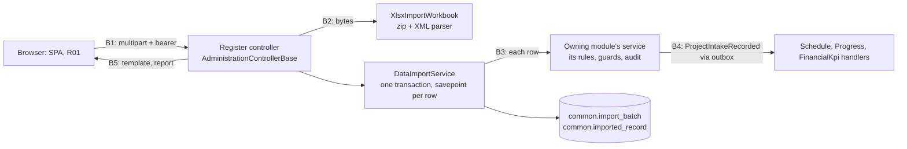

# Threat Model — Migration Data Import (TASK-102)

| Field | Value |
| --- | --- |
| Feature | Per-register XLSX templates, the upload of a filled workbook, its validation and its all-or-nothing import through each owning module's rules, the legacy-ID lineage, and the project intake it publishes |
| Built by | TASK-102, commits `e3cb86b` (engine, reference registers) and the projects commit after it, on `dev`; no PR yet |
| Reviewed | `dev`, 2026-10-23 |
| Feature records | `data-import.md` |
| Spec | Development and Cybersecurity Guide §9.3, §9.5; Step 17 BE-027; WF-12 §5 (secure upload) by analogy; TASK-077 (input), TASK-079 (CSRF) |

Paths are under `src/backend/` unless stated.

## 1. Data flow and trust boundaries

**Upload.** The pipeline runs origin allowlist, CORS, CSRF (multipart needs the bearer token), authentication, the `SensitiveWrite` limit and `DATA_IMPORT`. The action raises the body limit to 10 MiB + 1 MiB and reads the form (`Api/Controllers/AdministrationControllerBase.cs:117`). The file name obeys `TextInput` (`:125`).

**Parse.** The workbook is untrusted: a zip of XML parts. The reader prohibits DTDs and resolves nothing (`Infrastructure/DataImport/XlsxImportWorkbook.cs:43`), caps every decompressed part at 64 MiB whatever the archive declares (`:24`, `CappedStream` at `:441`), and stops at 5,002 rows (`:359`). Every cell obeys `TextInput` and its column's shape (`Application/Common/DataImport/ImportCellParser.cs:35`).

**Write.** Each row goes through the owning module's service, which applies its own validation, database guards and audit. A refused row rolls back to its savepoint (`Infrastructure/Persistence/DataImport/ImportRepository.cs:47`). Nothing commits unless every row passed and the import was asked for.

**Who imports.** Only R01 holds `DATA_IMPORT` (`Application/Common/Authorization/PermissionCatalogue.cs`, shipped grants). The service checks it again (`DataImportService.cs:280`).

## 2. Threats

| ID | STRIDE | Threat | L | I | Inherent | Control and evidence | Residual | Status | Finding |
| --- | --- | --- | --- | --- | --- | --- | --- | --- | --- |
| DI-T01 | E | A user other than R01 downloads a template, validates or imports | 1 | 3 | Medium | `[RequirePermission(DataImport)]` on every import endpoint, checked again in `DataImportService.cs:280`. `ImportEndpointTests.EveryRegisterHasATemplateAndAnImportBothProtectedByDataImport`; `DepartmentImportTests.OnlyAHolderOfDataImportMayImport`; `ShippedGrantTests.OnlyR01ImportsMigrationData` | Low | MITIGATED | — |
| DI-T02 | I | An XML external entity or entity expansion in a workbook part reads server files or exhausts memory (XXE, billion laughs) | 2 | 3 | High | `DtdProcessing.Prohibit`, `XmlResolver = null` (`XlsxImportWorkbook.cs:43`). `XlsxImportWorkbookTests.AWorkbookCarryingADocumentTypeDefinitionIsRefused` | Low | MITIGATED | SR-78 |
| DI-T03 | D | A decompression bomb, or a sheet of millions of rows, exhausts the API's memory | 2 | 2 | Medium | 10 MiB upload; 64 MiB per decompressed part; reading stops past the row limit (`XlsxImportWorkbook.cs:24`, `:359`, `:441`). `APartThatDecompressesPastTheCapIsRefused`, `ReadingStopsAtTheRowLimit` | Low | MITIGATED | — |
| DI-T04 | D | A 5,000-row import holds one transaction and a per-register advisory lock for its whole run, delaying other writes to the rows and tables it touches | 2 | 2 | Medium | The transaction is bounded by 5,000 rows and the per-user write rate limit; the duration of a full-size import has not been measured | Medium | PARTIAL | SR-79 |
| DI-T05 | E | The import loads records around the approval workflows: projects ACTIVE without WF-11 review, R04 granted to their managers, entities SUSPENDED, users DISABLED | 2 | 3 | High | R01 only; every row through its module's rules and guards; governed rows (master data, KPI definitions) land DRAFT so their separation of duties holds (`data-import.md` D-6); every row audited by its module and every batch as `<Module>.RecordsImported` with the file's SHA-256. `DATA_IMPORT` remains granted after the cutover | Medium | PARTIAL | SR-80 |
| DI-T06 | T | Text imported from the legacy system is later opened in a spreadsheet as a formula | 2 | 2 | Medium | Report exports neutralize formula-like text (`SpreadsheetSafety`, BR-RPT-039); the template quote-prefixes formula-like reference values (`XlsxImportWorkbook.cs:161`). `XlsxImportWorkbookTests.TheTemplateReadsBackAsItsHeaderAndListsItsColumnsAndReferenceValues` | Low | MITIGATED | — |
| DI-T07 | T | A cell or the file name carries control characters, an unpaired surrogate or over-long text | 2 | 2 | Medium | `TextInput` on every cell (`ImportCellParser.cs:35`) and the file name (`AdministrationControllerBase.cs:125`); column lengths. `ImportCellParserTests.TextIsHeldToItsLengthAndToTheCharactersEveryFieldRefuses` | Low | MITIGATED | — |
| DI-T08 | R | No one can show who loaded which records from which file | 2 | 2 | Medium | Batch audit with the file's SHA-256 and counts (`DataImportService.cs:84`, `:257`); lineage row per record. `DepartmentImportTests.AnImportCreatesTheDepartmentsInTheirLegacyStateWithLineageAndAudit` | Low | MITIGATED | — |
| DI-T09 | T | A workbook loaded twice, or two imports of a register at once, creates duplicate records | 2 | 2 | Medium | Lineage unique per register and legacy ID, a loaded ID skipped (`DataImportService.cs:201`); imports of one register serialised (`ImportRepository.cs:22`). Second load in `AnImportCreatesTheDepartments…`; `DataImportServiceTests.ARowLoadedByAnEarlierBatchIsSkippedNotLoadedAgain` | Low | MITIGATED | — |
| DI-T10 | I | The report echoes cell values back (R-25) | 1 | 2 | Low | Issues carry the row, the column and a code, never a value. `DataImportServiceTests.EveryBadCellAndEveryRefusedRowIsReportedAndNothingIsCommitted` | Low | MITIGATED | — |
| DI-T11 | S | Another site makes a signed-in browser upload a workbook (multipart needs no preflight) | 2 | 2 | Medium | `CsrfProtection` refuses a safelisted body without the bearer token. `CsrfProtectionTests.ARequestIsForgeableUnlessItCarriesTheTokenOrAPreflightedBody` | Low | MITIGATED | — |

Counts by inherent rating: High 2, Medium 8, Low 1.

## 3. Change log

| Date | Change |
| --- | --- |
| 2026-10-23 | First model (TASK-102) |
