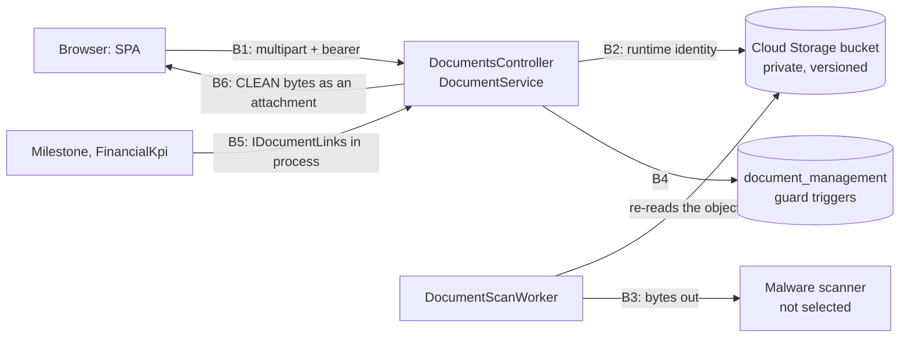

# Threat Model — Document Upload and Evidence (WF-12)

| Field | Value |
| --- | --- |
| Feature | Upload (multipart), validation, storage in the private object store, malware scanning, download, versions, links and evidence pinned to exact versions, with the evidence consumers Milestone (WF-14 milestones) and FinancialKpi |
| Built by | TASK-037 (PR #42), TASK-038 (PR #43); evidence consumers TASK-050 (PR #56) and TASK-052 |
| Reviewed | `dev` at `6f19809`, 2026-10-16 |
| Feature records | `document-management.md`, `document-library-ui.md` |
| Spec | WF-12 §5 (secure upload), §8 (authorization, §8.3 external entities), §16 DOC-CC-01 to -28, §23.1; Cybersecurity Guide CS-012/016 (malware), CS-019, CS-028 |

Paths are under `src/backend/` unless stated.

## 1. Data flow and trust boundaries

**Upload.** The pipeline runs origin allowlist, CORS, CSRF (multipart needs the bearer token), authentication, the `SensitiveWrite` limit (120 a minute per user) and `DOCUMENT_UPLOAD`. The action raises the body limit to 100 MiB + 1 MiB, then reads the form. `DocumentService` checks the **declared** media type against the allowlist and authorizes on the project's anchors, the classification and the project's state. It then streams the bytes, hashing them, to `documents/<documentId>/<versionId>`. The version is born SCAN_PENDING.

**Scan.** No inbound scanner callback exists. `DocumentScanWorker` pulls SCAN_PENDING versions, re-reads each object and sends it to `IMalwareScanner`. No provider is wired (`UnconfiguredMalwareScanner`), so nothing becomes CLEAN (`document-management.md` F-2).

**Serve.** Both content routes go through `DocumentService.OpenCleanAsync`. It authorizes, then refuses anything not CLEAN, then streams `application/octet-stream` with `Content-Disposition: attachment`, `nosniff`, `no-store` and the API's `default-src 'none'` CSP. The SPA saves the bytes as a Blob, never opening them as a page. No preview, export or report reads document bytes.

**Who uploads today.** Only R04 holds `DOCUMENT_VIEW` and `DOCUMENT_UPLOAD`, at ENTITY. In practice the uploaders are **external entity project managers**, and AHDA staff open what they upload. That is why the upload-side threats rate as they do.

## 2. Threats

| ID | STRIDE | Threat | L | I | Inherent | Control and evidence | Residual | Status | Finding |
| --- | --- | --- | --- | --- | --- | --- | --- | --- | --- |
| DOC-T01 | S | An uploader declares an allowed type (`application/pdf`) for an executable, HTA, HTML, SVG, macro-enabled Office file, archive or polyglot. It is stored under its real name (`report.pdf.exe`) and later run by AHDA staff who download it | 2 | 3 | High | Only the client's declared type is checked (`Application/Features/DocumentManagement/DocumentUploads.cs:19`, `DocumentUploadPolicy.cs:18-23`): no signature check, no extension allowlist, no declared-against-sniffed comparison (WF-12 §5.1, DOC-CC-05). Served as an attachment; only CLEAN is served; the scanner fails closed. Inert today only because nothing becomes CLEAN | High | GAP | SR-38 |
| DOC-T02 | S | A file name with bidi or format characters (U+202E and the like) or a double extension shows `invoice‮fdp.exe` as `invoiceexe.pdf` in the library and the save dialog | 2 | 2 | Medium | `DocumentFileNames.Clean` removes control characters (category Cc) and path segments only (`DocumentFileNames.cs:12-13`); format characters (Cf) pass | Medium | GAP | SR-43 |
| DOC-T03 | T | A file name carries a path, CR/LF or quotes to traverse the store or inject into `Content-Disposition` | 2 | 2 | Medium | The object key is two platform GUIDs, never the name (`DocumentUploads.cs:29-30`); the name is cut to its last segment; the local store refuses keys leaving its root; `Content-Disposition` is RFC 6266-encoded. `DocumentUploadTests.AFileNameKeepsItsLastSegmentWithoutControlCharacters`; `DocumentStorageTests.AKeyThatLeavesTheStoreIsRefused`; `UploadFormTextValidationTests.AnUploadFormFieldOrFileNameHoldingAControlCharacterIsRefused` | Low | MITIGATED | — |
| DOC-T04 | I | Stored XSS: HTML, SVG or script-bearing PDF content rendered inline on the platform's origin | 2 | 3 | High | Always `application/octet-stream`, `attachment`, `nosniff`, `no-store` (`PMPlatform.Api/Controllers/AdministrationControllerBase.cs:97-101`); API CSP `default-src 'none'` and CORP `same-origin` (`PMPlatform.Api/Middleware/SecurityHeaders.cs:17-29`); the SPA saves a Blob (`src/frontend/src/shared/api/saveFile.ts:4-13`). `DocumentEndpointTests.ContentIsServedAsAnAttachmentThatIsNeverSniffedNorCached` (an HTML payload), in CI from this PR | Low | MITIGATED | SR-39 |
| DOC-T05 | I | SCAN_PENDING, SCAN_FAILED or QUARANTINED bytes are served by some route | 2 | 3 | High | One gate, `OpenCleanAsync` (`DocumentService.cs:346-367`), for both content routes; no other reader of `IDocumentStorage`; a QUARANTINED attempt audited; the bucket is not public; the object key is in no representation. `EvidenceAvailabilityTests.AnEicarUploadIsQuarantinedAndIsNeverServedNorEvidence`; `ScanLifecycleTests.WithoutAScannerNothingIsEverClean`, in CI from this PR | Low | MITIGATED | SR-39 |
| DOC-T06 | T | The object is replaced after it was scanned or pinned, so other bytes are served as CLEAN evidence | 1 | 3 | Medium | The application writes once (`CloudStorageDocumentStorage.cs:24` `IfGenerationMatch = 0`); the key and checksum are immutable in the database; bucket versioning and soft delete. Missing: no checksum or generation check when scanning or serving (`DocumentScanning.cs:74`, `DocumentService.cs:365`), which WF-12 §5.3 requires; the runtime holds `roles/storage.objectUser` (`infra/terraform/storage/main.tf:62`), which can overwrite and delete | Medium | PARTIAL | SR-44 |
| DOC-T07 | S | A scan verdict is spoofed: a forged callback, a forged provider answer, or a direct database write of CLEAN | 1 | 3 | Medium | No inbound callback; verdicts only from the worker, written by `svc.document-scan`; the database allows born SCAN_PENDING, CLEAN and QUARANTINED final, SCAN_FAILED back to PENDING only. `EvidenceAvailabilityTests.APinnedVersionsVerdictCanNeverBeChangedInTheDatabase`. The provider leg (TLS, authentication, response integrity) is not built | Low | DEPENDS | SR-41 |
| DOC-T08 | T | The scanner fails open: an error, a timeout, an oversized file or an unknown answer becomes CLEAN | 2 | 3 | High | Unconfigured means no pass (`DocumentScanning.cs:26-29`); any exception leaves the version pending; an unknown verdict throws (`:46-52`). `ScanLifecycleTests.AScannerThatCannotBeReachedLeavesTheVersionPendingForTheNextPass`, `.WithoutAScannerNothingIsEverClean`, in CI from this PR. The adapter that maps the provider's answers is TASK-037's follow-up with the provider (SR-41) | Low | MITIGATED | SR-40 |
| DOC-T09 | T | Evidence is pinned to a non-CLEAN version or another document's version, or a later version or rescan changes what an approved record relied on | 2 | 3 | High | Active link, same document, CLEAN version (`DocumentLinkService.cs:122-142`); the `guard_evidence_reference` trigger; immutable versions; Milestone freezes evidence after submission. `AchievementEvidenceTests.MandatoryEvidenceMustBeHeldCleanBeforeSubmission`, `.EvidenceBelongsToItsRevision`; `EvidenceAvailabilityTests.ANewVersionNeverAltersEvidencePinnedToAnEarlierOne` | Low | MITIGATED | SR-42 |
| DOC-T10 | I | IDOR: a reader of document A reads a version, content or evidence of document B by swapping an id | 2 | 3 | High | A version must belong to the route's document before the document is authorized (`DocumentService.cs:305-319`); evidence authorizes its link's document (`:322-340`); 404 per R-47. `DocumentAuthorizationTests`; `DocumentEndpointTests.AnUnknownDocumentOrEvidenceIsNotFound`, in CI from this PR. No test sends a mismatched document and version pair | Low | MITIGATED | SR-42 |
| DOC-T11 | I | An external entity user reads, lists or counts another entity's document, or an internal one | 2 | 3 | High | Absolute entity isolation (`AuthorizationEngine.cs:231-240`); the list filtered in SQL before paging and counting (`DocumentRepository.cs:54`, `:232-247`). `RecordScopeTests.AnExternalUserWithoutAnEntityReachesNothing`, `.TheEntityProjectManagersClauseIsTheirProjectAndTheirEntity`; `DocumentAuthorizationTests.TheEntityProjectManagerUploadsViewsAndSeesHistoryOnTheirOwnProjectOnly`, `.EachPersonsListIsExactlyTheDocumentsTheyMayOpen` | Low | MITIGATED | SR-42 |
| DOC-T12 | I | An external user sees what WF-12 §8.3 withholds: prior versions, every link's target, and documents of an internal-only classification | 2 | 2 | Medium | `DOCUMENT_VIEW` opens every version and link alike; classification is a rank, with no internal-only flag. Depends on the Appendix A grants (PMO) and the classification taxonomy (UGV-01, AHDA Cybersecurity) | Medium | PARTIAL | SR-45 |
| DOC-T13 | E | A user uploads to a project, or at a classification, they cannot write, or to a CLOSED project | 2 | 2 | Medium | Engine on the project's anchors and the classification, then the closed check (`DocumentService.cs:66-77`, `DocumentAccess.cs:21-36`). `ClosedProjectWriteTests`; `DocumentAuthorizationTests.NoOneReachesADocumentAboveTheirClearance` | Low | MITIGATED | — |
| DOC-T14 | T | A user who can only view a document attaches it as evidence on another project's record, or attaches an ARCHIVED document, so a milestone or budget gate is met by unrelated evidence its approver may not be able to open | 2 | 2 | Medium | Link and designation need only `DOCUMENT_VIEW` (`DocumentLinkService.cs:30`, `:117`); no check that the document's project is the record's or that it is ACTIVE (WF-12 §8.1, DOC-CC-15) | Medium | GAP | SR-46 |
| DOC-T15 | E | A manager reclassifies a document downward, widening who can see it | 1 | 3 | Medium | `DOCUMENT_MANAGE` on the old and new classification (`DocumentService.cs:114`, `:131-138`); audited with before and after; no one holds `DOCUMENT_MANAGE`. No step-up or second approver for a downgrade (WF-12 §8.1) | Low | PARTIAL | SR-47 |
| DOC-T16 | R | No one can show afterwards who downloaded a document or its evidence | 2 | 2 | Medium | Uploads, versions, metadata, archive, scan, links, evidence and QUARANTINED attempts are audited; a CLEAN download is not (`document-management.md` F-10; WF-12 §23.1, Guide §9.4) | Medium | GAP | SR-48 |
| DOC-T17 | T | Document history or its bytes is deleted or rewritten to erase evidence | 1 | 3 | Medium | `refuse_deletion` and update guards on all four tables; no delete API; bucket versioning, soft delete, `force_destroy = false`, an off-bucket copy. `UnlinkTests.TheDatabaseRefusesToDeleteOrReopenDocumentHistory`. The runtime's bucket role can still delete live objects (DOC-T06) | Low | PARTIAL | SR-44 |
| DOC-T18 | D | An oversized body exhausts the API before validation | 2 | 2 | Medium | The limit is set before the body is read (`DocumentUploadForm.cs:38-61`); form binding off; 413. `DocumentEndpointTests.AnUploadIsValidatedLimitedAndTypedBeforeAnythingIsStored` | Low | MITIGATED | — |
| DOC-T19 | D | Parallel large downloads or uploads fill the instance's memory: Cloud Run's filesystem is in memory, the Cloud Storage adapter copies each object whole to a temp file (`CloudStorageDocumentStorage.cs:29-45`), and downloads are not rate-limited | 2 | 2 | Medium | Upload limit only; no limit on download concurrency (PROD: 4 GiB, 80 concurrent requests) | Medium | GAP | SR-49 |
| DOC-T20 | D | One uploader at 120 × 100 MiB a minute grows storage without quota and starves the single FIFO scan queue | 2 | 2 | Medium | The per-user rate limit and the 100 MiB cap; no quota and no fair queueing (`DocumentScanning.cs:32-65`) | Medium | GAP | SR-49 |
| DOC-T21 | D | A zip bomb or deeply nested Office file exhausts the scanner | 2 | 2 | Medium | The API never parses content. `.zip` is not allowed by declared type, which DOC-T01 bypasses; limits are the provider's | Medium | DEPENDS | SR-41 |
| DOC-T22 | I | The bucket is read directly by a guessed or leaked object key | 1 | 3 | Medium | Keys are UUIDv7 and in no representation; uniform access and public access prevention enforced (`infra/terraform/storage/main.tf:28-29`); no signed URLs | Low | MITIGATED | — |
| DOC-T23 | I | Orphaned objects (a failed save after the store write) and quarantined malware stay at rest in the live bucket | 1 | 2 | Low | Private bucket; quarantined bytes never served; no sweeper and no separate quarantine bucket (`document-management.md` F-9) | Low | PARTIAL | SR-50 |
| DOC-T24 | I | Every document, confidential ones included, goes to a third-party scanning provider outside the approved region or contract (CS-019, CS-031) | 2 | 3 | High | None yet: no provider is selected (`document-management.md` F-2). The port passes the bytes and the file name (`IMalwareScanner.ScanAsync`) | High | DEPENDS | SR-41 |
| DOC-T25 | T | A client retry creates a duplicate document or version (WF-12 §5.1, DOC-CC-27) | 2 | 1 | Low | `Idempotency-Key` required, not replayed (`document-management.md` F-15) | Low | PARTIAL | SR-50 |
| DOC-T26 | T | Metadata injection through the title, description or search filter | 2 | 2 | Medium | `TextInput` on form fields; EF parameters; LIKE escaping; `q` capped at 200; React text rendering and the sink lint. `UploadFormTextValidationTests`; `outputEncoding.test.tsx` | Low | MITIGATED | — |
| DOC-T27 | S | CSRF: another site makes a signed-in browser upload (multipart needs no preflight) | 2 | 2 | Medium | `CsrfProtection` refuses a safelisted body without the bearer token. `CsrfProtectionTests.ARequestIsForgeableUnlessItCarriesTheTokenOrAPreflightedBody` | Low | MITIGATED | — |

Counts by inherent rating: High 8, Medium 17, Low 2.

## 3. The tests that prove it, and CI

Until this PR no CI step ran `PMPlatform.Tests.Integration.DocumentManagement` (`input-validation.md` F-7). The proofs of DOC-T04, T05, T08, T10 and T11 were therefore run by hand only, and a regression in any of them would have merged green. This PR adds a "DocumentManagement integration tests" step to the `backend-endpoint-hardening` job of `ci-quality-gates.yml`. The 21 tests passed locally on `dev` before it was added. The step is in that job because `backend` (10 min) and `backend-risk-governance` (about 9 min) are at their cap.

| Test class | Tests | CI |
| --- | --- | --- |
| `DocumentEndpointTests`, `DocumentAuthorizationTests`, `EvidenceAvailabilityTests`, `ScanLifecycleTests`, `UnlinkTests` (Integration.DocumentManagement) | 21 | **From this PR** |
| `AchievementEvidenceTests` (Milestone), `ClosedProjectWriteTests` (Closure), `UploadFormTextValidationTests` (InputValidation), `CsrfProtectionTests` (EndpointHardening), `DocumentSchemaTests` (Persistence) | | Yes |
| Unit: `DocumentUploadTests`, `DocumentStorageTests`, `RecordScopeTests`; SPA document tests | | Yes |

## 4. Spec controls against evidence

| WF-12 control | Evidence | Gap |
| --- | --- | --- |
| Unsafe file quarantined, never served or evidence (DOC-CC-07/08) | DOC-T05 | A real provider (SR-41) |
| Content signature and extension, not the declared type alone (DOC-CC-04/05, §5.1) | — | SR-38 |
| Hash verified on retrieval (§5.3) | — | SR-44 |
| External isolation, not enumerable (DOC-CC-20/22) | DOC-T11 | Prior versions and links (SR-45) |
| Version pinning (DOC-CC-10 to -13) | DOC-T09 | — |
| Delete protection (DOC-CC-16/17) | DOC-T17 | Bucket role (SR-44) |
| Link needs authorization to the document and the record (DOC-CC-14/15) | Record side only | SR-46 |
| Sensitive access audited (§23.1) | Not for downloads | SR-48 |
| Resource abuse controlled (§23.1) | Upload size and rate | SR-49 |
| Retries idempotent (DOC-CC-27) | Key required only | SR-50 |

## 5. Record claims found stale

| Record | Claim | On `dev` |
| --- | --- | --- |
| `document-management.md` F-14 | A link for a CLOSED project's records is refused | Link, unlink, designate and withdraw authorize `DOCUMENT_VIEW` (read), so DocumentManagement never refuses them; only the consuming module's state check does |
| `document-management.md` F-8 | No module links or pins | Milestone and FinancialKpi both do |
| `document-management.md` F-5 | Archives are excluded | A ZIP declared as PDF is accepted (DOC-T01) |
| `document-management.md` D-10 | The store never replaces or deletes | True of the code; the runtime's bucket role can do both (DOC-T06) |
| `document-management.md` §6 | The integration tests verify the acceptance criteria | They ran in no CI step until this PR |

## 6. Change log

| Date | Change |
| --- | --- |
| 2026-10-16 | First review (TASK-081); the module's integration tests added to CI |
