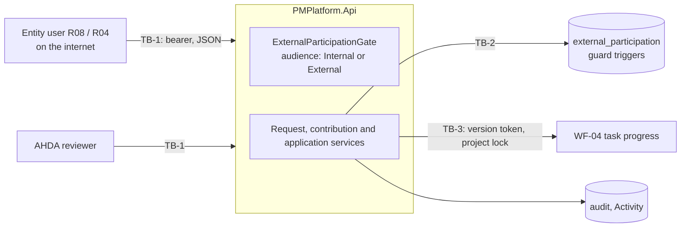

# Threat Model — External Entity Participation (WF-13)

| Field | Value |
| --- | --- |
| Feature | Update requests AHDA issues to an external entity; the entity user's view of them, their answers and submission; AHDA's review; applying an accepted answer to its source record under a version token; the external user population (ENTITY scope, per-project assignment, ADR-013 and ADR-019 limits) |
| Built by | TASK-066 (PR #76), TASK-067 (PR #77), on the engine (PR #34) and FG-03 administration (PR #35) |
| Reviewed | `dev` at `6f19809`, 2026-10-16 |
| Feature records | `external-participation.md`, `external-participation-ui.md` |
| Spec | WF-13 §8 (external security, safe projection), §23 (cybersecurity, privacy, audit, non-repudiation), Appendix C; FG-03 REV-IAM-006 |

Paths are under `src/backend/` unless stated.

## 1. Data flow and trust boundaries

The external user is the least trusted authenticated actor on the platform. Every decision is made on the request's **addressed entity**, not the project's, and the response is projected by audience: anyone who is not an active internal principal gets the external projection. Accepted answers reach WF-04 only through `SourceApplicationService`, under WF-04's own lock and row version.

## 2. Threats

| ID | STRIDE | Threat | L | I | Inherent | Control and evidence | Residual | Status | Finding |
| --- | --- | --- | --- | --- | --- | --- | --- | --- | --- |
| EXT-T01 | I | An entity-A user changes a request or contribution id to read, answer, edit or submit entity B's record on the same project | 3 | 3 | Critical | The subject is anchored on the request's addressed entity (`Application/Features/ExternalParticipation/ExternalParticipationAccess.cs:25-44`); absolute isolation for external principals (`AuthorizationEngine.cs:230-242`); the gate answers 404 before any write (`ExternalParticipationGate.cs:103-129`); the database ties each revision to its request's project and entity. `EntityIsolationTests.AnEntityUserCannotReachAnotherEntitysRequestsOrContributionsByAnyCall` | Medium | MITIGATED | SR-62 |
| EXT-T02 | I | An entity user enumerates another entity's requests through list filters, `totalCount`, revision or attempt lists, or a 403-versus-404 difference | 3 | 2 | High | Scope in SQL before filters, count and paging (`ExternalParticipationRepository.cs:46`, `:78`, `:181-195`); an out-of-scope record is the same 404 as a random id; a DRAFT is 404 to the entity. `EntityIsolationTests.AnEntityUserCannotReachAnotherEntitysRequestsOrContributionsByAnyCall` (B's filter gives 0 of 0); `.ADraftRequestDoesNotExistForTheEntity` | Low | MITIGATED | SR-62 |
| EXT-T03 | I | An R08 user reaches every request addressed to their entity on every project, not only the projects granted (EXT-CC-03, REV-IAM-006) | 2 | 2 | Medium | A per-project assignment covers only its project. But only R04 must name a project (`AccessRelationshipService.cs:294`), and a per-project assignment is refused for a project the entity does not deliver (`:295`), so a non-delivering entity addressed on another entity's project can only be served by an entity-wide R08. The CI isolation test seeds per-project grants by SQL that the API would refuse | Medium | PARTIAL | SR-30 |
| EXT-T04 | I | An entity user learns that AHDA is drafting a request for them (its id, project and timing) from the Activity feed, though a DRAFT "does not exist for the entity" (WF-13 §4.1) | 3 | 1 | Medium | The WF-13 endpoints hide DRAFTs. Activity does not: draft events are templated and projected with no status filter (`AuditActivity/ActivityTemplateCatalogue.cs:232-234`, `ActivityProjection.cs:17-40`) and scoped to the addressed entity, which R08 reads at ENTITY | Medium | GAP | SR-66 |
| EXT-T05 | I | An entity user infers a masked internal field by filtering on it (`?reviewerUserId=` on requests, `?actorUserId=` on Activity) and reading `totalCount` | 2 | 1 | Low | The fields are withheld from the projection, but the filters apply to external callers unchanged (`ExternalParticipationRepository.cs:73-76`; `AuditReadRepository.cs:102-105`) | Low | GAP | SR-67 |
| EXT-T06 | I | The external projection carries internal-only data: reviewer, issuer, configuration version, internal note, source version, a confidential task title, internal ids | 3 | 2 | High | Projection by audience (`ExternalParticipationAccess.cs:90-91`, `ExternalParticipationViews.cs:16-21`, `:96-127`); withheld fields omitted on the wire; every DTO property classified by a test; the SPA drops them again. `EntityIsolationTests.TheEntitysProjectionCarriesNoInternalOnlyField`; `ExternalProjectionTests.EveryRequestFieldIsClassified`, `.TheExternalRequestWithholdsEveryInternalField`. By design still shown: the live task title (`targetLabel`, TBC-EXT-020) and internal GUIDs (EXT-CC-26) | Medium | PARTIAL | SR-63 |
| EXT-T07 | I | The internal review note or review history reaches the entity through another channel: revision or request lists, audit, Activity, export, notification | 3 | 2 | High | The list paths project too; audit copies no free text; Activity templates carry no values; WF-13 has no export and publishes no notification. `TheEntitysProjectionCarriesNoInternalOnlyField` checks four entity-readable paths for the note | Low | MITIGATED | SR-62 |
| EXT-T08 | E | An entity user keeps acting after their entity is suspended or retired, their account is disabled, or their assignment ends, by reusing a token or a deep link | 2 | 3 | High | The principal is read on every request: inactive unless the user is ACTIVE and an external user's entity is ACTIVE; only current assignments grant (`AuthorizationRepository.cs:33-60`). `EntityIsolationTests.AnEntityUserReachesOnlyTheProjectsItIsAssignedToAndOnlyWhileAssigned`; `ADisabledUsersTokenGrantsNothingFromTheNextRequest`. No test suspends an entity while its user holds a token | Medium | PARTIAL | SR-64 |
| EXT-T09 | S | An AHDA user, or another entity's user, answers or submits as the entity | 2 | 3 | High | `EXTERNAL_CONTRIBUTION_RESPOND` ships to R08 only; the responder must be an active external user of the addressed entity, checked at create, update, issue and reassignment; the workflow actor is the named responder; the database requires the responder and contributor to be the entity's external users. `ExternalParticipationGuardTests.ARequestsPeopleAreItsEntitysOnOneSideAndAhdasOnTheOther`; `UpdateRequestLifecycleTests.ARequestIsIssuedOnlyWhenEverythingItNeedsHolds` | Medium | MITIGATED | SR-62 |
| EXT-T10 | S | A colleague at the same entity, who can see the request but is not its named responder, drafts or submits the answer | 3 | 2 | High | RESPOND at ASSIGNED, with the responder as the workflow actor (`ExternalParticipationGate.cs:115`, `AuthorizationEngine.cs:214`). `ShippedGrantTests.AnEntityUserReachesOnlyItsOwnEntitysRequestsOnTheProjectItIsAssignedTo` (unit); no integration test, as the suite has one entity-A user | Low | MITIGATED | SR-64 |
| EXT-T11 | E | An entity project manager (external R04, which ships MANAGE, REVIEW and APPLY at OWN) creates, issues, cancels, reviews or applies | 2 | 3 | High | The AHDA-only permission set goes through `CheckInternalAsync`: refused and audited unless the caller is an active internal principal (`ExternalParticipationAccess.cs:63-79`); the database requires reviewers to be internal. `ContributionReviewTests.AnEntityProjectManagerNeitherRequestsNorReviews`; `SourceApplicationTests.OnlyAhdaAppliesAndOnlyAhdaSeesTheAttempts` | Medium | MITIGATED | SR-62 |
| EXT-T12 | R | A responder denies submitting a value, or a reviewer a decision; or a submitted value is altered so the record no longer proves what was submitted (§23.3) | 2 | 2 | Medium | The submitter fixed at submit; the database freezes the submitted revision and the decided review; an audit event per transition; attempts keep their idempotency key and correlation id. `ContributionReviewTests.AReviewerCannotEditASubmittedRevisionOnlyAcceptReturnOrReject`; `ExternalParticipationGuardTests.ASubmittedRevisionCannotBeRewrittenByAnyWriter`. No hash of the submitted values (record F-1); the assignment that authorised the submission is not recorded (§23.2) | Low | PARTIAL | SR-68 |
| EXT-T13 | T | A responder submits an out-of-range percentage, a wrong type, a field outside the schema, a duplicate field or extra body properties | 3 | 2 | High | A typed allowlist (`ContributionSchemas.cs:35-55`); unknown and repeated fields refused, type and range checked (`ContributionValues.cs:20-88`); fixed request records; WF-04 checks 0 to 100 again. `UpdateRequestLifecycleTests.AnAnswerHoldsTheSchemasFieldsAndNothingElse`; `ContributionValuesTests.APercentageOutsideItsTypeOrRangeIsRefused` | Low | MITIGATED | SR-62 |
| EXT-T14 | T | An accepted value is applied to a different source record than the request names | 2 | 2 | Medium | The target must be the project's at create, update, issue and submit; the database freezes it once issued; the answer names no target. `UpdateRequestLifecycleTests.ARequestIsIssuedOnlyWhenEverythingItNeedsHolds` | Low | MITIGATED | — |
| EXT-T15 | T | The source task changes between the answer and the application, and the stale value overwrites it | 2 | 2 | Medium | The version token captured at submit; WF-04 compares it under the task lock; a CONFLICT writes nothing. `SourceApplicationTests.AChangedSourceIsAConflictNotAnOverwrite`, `.RacingAttemptsApplyARevisionOnce` | Low | MITIGATED | — |
| EXT-T16 | T | A replayed submit, decision or apply has a second effect | 2 | 2 | Medium | Idempotency key scoped to the caller and replayed for apply; one APPLIED attempt per revision; state edges in code and database. `SourceApplicationTests.AnAcceptedReportIsAppliedOnceThroughWf04WithItsLineage`; `ContributionReviewTests.OnlyTheAssignedReviewerDecidesAndOnlyOnce` | Low | MITIGATED | — |
| EXT-T17 | T | The reviewer, or any writer including SQL, changes a submitted revision's values | 2 | 2 | Medium | No edit outside DRAFT; the database refuses value writes unless the revision is a DRAFT of an open request. `ExternalParticipationGuardTests.ASubmittedRevisionCannotBeRewrittenByAnyWriter` | Low | MITIGATED | — |
| EXT-T18 | E | One AHDA user drafts the request, names themselves reviewer, accepts, revalidates and applies with no second pair of eyes | 1 | 2 | Low | Contributor external and reviewer internal by code and database, so a contributor never reviews; the assigned reviewer decides. WF-13 asks for assignment, not separation (EXT-CC-10/12); SCR-161 defaults the reviewer to the drafting user | Low | DEPENDS | SR-69 |
| EXT-T19 | T | Stored XSS: an entity user puts markup in a free-text answer that AHDA's reviewer renders, stealing an AHDA session | 2 | 3 | High | Control characters and length checked on every bound string (`PMPlatform.Api/Validation/RequestTextValidation.cs`); 2,000 characters a field; React text rendering with no HTML sink in the feature; deny-all CSP on API responses. `InputValidation.RequestTextValidationTests`; the feature's frontend tests render the text. Markup is stored as typed, so any future export or e-mail template must encode it again | Medium | MITIGATED | SR-65 |
| EXT-T20 | D | An entity user floods the platform: many drafts, large answers, expensive list reads | 2 | 1 | Low | One open revision per request; field count and length bounds; the `SensitiveWrite` limit; pages of at most 200. Reads are not rate-limited, and the request list reads one project and one task per row | Low | PARTIAL | SR-70 |
| EXT-T21 | I | Notifications or events leak WF-13 data to other people | 2 | 2 | Medium | WF-13 publishes no notification or domain event (record F-6); Activity is scoped by entity and hides AHDA actors from external readers | Low | MITIGATED | — |
| EXT-T22 | S | An insider provisions or extends external access: creates an external user bound to an identity they control, or re-grants an expired R08 | 1 | 3 | Medium | An active internal sponsor and an external-eligible role in the user's own entity (`AccessRelationshipService.cs:286-297`); no self-administration; every assignment audited; R01 only. Identity proofing and invitation are FG-03's (§9.2) | Medium | DEPENDS | SR-71 |
| EXT-T23 | E | An entity user keeps answering, or AHDA keeps applying, on a CLOSED or COMPLETED project | 2 | 2 | Medium | Writes to a CLOSED project refused; requests drafted only for live states; WF-04 refuses a percentage unless ACTIVE; closure ends the project's assignments. No WF-13 test drives a CLOSED or COMPLETED project through answer, decision or apply (Appendix C scenario 9) | Low | PARTIAL | SR-72 |
| EXT-T24 | I | Entity users get more than ADR-019's "Project Dashboard and nothing further": report run and export, and the Activity feed | 2 | 2 | Medium | Reports restrict R08 to the entity set with masking (`reports.md` D-6); R08 holds `REPORT_EXPORT` and `ACTIVITY_VIEW` at ENTITY. ADR-019 is not in the ADR register | Medium | DEPENDS | SR-73 |
| EXT-T25 | I | An AHDA manager addresses project P's request to an entity that takes no part in P; that entity's R08 users then see the request and its target | 2 | 2 | Medium | Only the entity's status is checked (`ExternalUpdateRequestService.cs:53`, `:61`; `ExternalParticipationReferences.cs:37-40`). WF-13 §8.3 allows several entities on a project; whether any entity may be addressed is to be confirmed | Medium | DEPENDS | SR-30 |
| EXT-T26 | D | A responder saves a draft while AHDA cancels the request; the guard trigger's refusal is not translated and the API answers 500 instead of 409 (nothing is written) | 2 | 1 | Low | The database refuses the write; the error mapping does not cover this `restrict_violation` | Low | GAP | SR-70 |

Counts by inherent rating: Critical 1, High 9, Medium 12, Low 4.

## 3. REV-IAM-006

FG-03 marks REV-IAM-006 ("ENTITY + explicit Project/resource grant + enumeration protection") Closed. On `dev` it **holds partly**:

| Part | Verdict |
| --- | --- |
| ENTITY isolation | Holds (EXT-T01) |
| Explicit project grant | Partly: an R08 assignment may cover the whole entity (EXT-T03, RBAC-T11) |
| Enumeration protection | Holds across entities (EXT-T02); within an entity, Activity and filter leaks (EXT-T04, EXT-T05) |

## 4. Spec scenarios (WF-13 Appendix C) against evidence

| Scenario | Evidence | Gap |
| --- | --- | --- |
| 1 Entity isolation | EXT-T01 | Rests on per-project grants seeded by SQL (SR-30) |
| 2 Named responder only | EXT-T10 | Unit evidence only (SR-64) |
| 3 Safe projection | EXT-T06 | Task title and GUIDs (SR-63) |
| 4 Evidence pinned to CLEAN WF-12 versions | — | Not built (`external-participation.md` F-1) |
| 5, 6 Review and apply by AHDA only | EXT-T11 | — |
| 7, 8 Conflict and revalidation | EXT-T15 | — |
| 9 Closed or completed project | EXT-T23 | SR-72 |
| 10–12 Idempotency, immutability, audit | EXT-T16, T17, T12 | Content hash (SR-68) |

## 5. Record claims found stale

| Record | Claim | On `dev` |
| --- | --- | --- |
| `external-participation.md` F-15 | FG-03 has no rule tying an assignment to the project's entity | `AccessRelationshipService.cs:295` is that rule |
| `external-participation.md` D-7, §7 | Two entities answer through per-project R08 grants | The tests seed those grants by SQL that the API refuses (EXT-T03) |
| `external-participation.md`, `external-participation-ui.md` | The entity never sees the application outcome | It sees APPLIED in the contribution status and on Activity; only the SPA hides it |
| `external-participation.md` D-6 | A DRAFT does not exist for the entity | Activity shows it (EXT-T04) |
| `external-participation-ui.md` F-5 | The entity dashboard is not built | TASK-070 built it |
| FG-03 §24 | REV-IAM-006 Closed | Holds partly (§3) |

## 6. Change log

| Date | Change |
| --- | --- |
| 2026-10-16 | First review (TASK-081) |
