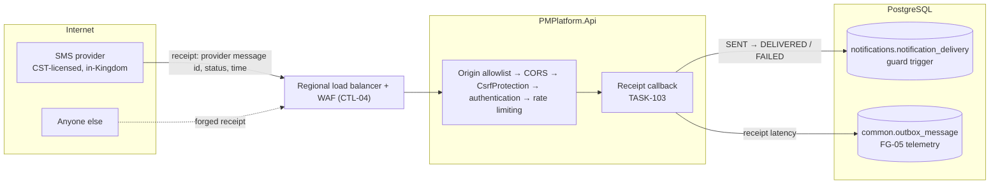

# Threat Model — SMS Delivery-Receipt Callback

| Field | Value |
| --- | --- |
| Feature | The inbound endpoint where the SMS provider reports what happened to each message (ADR-004; `SMS_DLR_CALLBACK_URL`) |
| Task | TASK-081, by its Participation Amendment: "ADR-004: the SMS delivery-receipt callback is a new inbound endpoint and belongs in the threat model" |
| Built by | **Not built.** TASK-103 (Integrate SMS Provider, Sender ID and Delivery Receipts) adds the provider adapter and the callback; the provider is OQ-012 / UGV-10 |
| Reviewed | `dev` at `6f19809`, 2026-10-16: the WF-15 runtime the callback will write to, and the API pipeline it will enter |
| Kind of review | **Design review.** The surface does not exist, so every threat is NOT BUILT and every control is a requirement on TASK-103 (§5) |
| Sources | ADR-004 (`adrs/ADR-register.md`); WF-15 §22, its API catalogue (`POST /api/internal/notifications/provider-callback` "authenticated/idempotent"), its error `PROVIDER_CALLBACK_INVALID` ("failed auth/signature/schema checks"), US-NTF-SYS-050/051, REV-NTF-014 and TBC-NTF-022; `environment-and-secrets.csv` rows `SMS_*`; CTL-16, CTL-22, CTL-27, CTL-33, CTL-50; `notification-runtime.md` D-10, F-2; `integration-monitoring.md` D-13, F-10; `csrf-protection.md` §7; `endpoint-hardening.md` |

## 1. Scope

| | Subject |
| --- | --- |
| **In** | The callback: who can call it, what it may change, what it records and logs, and how it behaves under load |
| **In** | The parts of WF-15 the callback will touch: `notification_delivery` (`status`, `delivered_at`, `provider_message_id`) and its guard trigger |
| **Out** | Sending SMS, templates, segment budget, opt-out (built, TASK-039; `notification-runtime.md`) |
| **Out** | Mobile number verification (TASK-031 `IMobileNumberVerifier`, waits for the same provider) |

## 2. Data flow and trust boundaries

Trust boundary **TB-1** is the internet to the edge. The provider is a third party, so a receipt from it is data to validate, never a command. **TB-2** is the API to the database. The callback runs as the notification service principal (`notification-runtime.md` D-17), not as a user.

What a receipt can change today, read from the code:

| Fact | Where |
| --- | --- |
| `notification_delivery` holds `provider_message_id`, `delivered_at` and `status`, and nothing writes `DELIVERED` yet | `PMPlatform.Domain/Notifications/NotificationDelivery.cs:40,47`; `NotificationDeliveryStatus.cs` |
| The guard allows `SENT → DELIVERED`, `SENT → READ` and `SENT → FAILED` **on every channel**, and freezes a row once it is DELIVERED or READ | `Migrations/20260930201535_TASK-039_GuardNotificationHistory.cs:150-162` |
| `FAILED` is retried: the worker sends it again at `next_attempt_at`, up to 5 attempts (`notification-runtime.md` F-5) | `NotificationSending.cs` |
| Every endpoint must declare `[AllowAnonymous]`, `[AllowAnyAuthenticatedUser]` or `[RequirePermission]`, or the API refuses to start | `PMPlatform.Api/Authorization/EndpointAuthorization.cs:22` |
| `CsrfProtection` refuses an unsafe-method request that carries neither `Authorization: Bearer` nor a non-form body (403 `CROSS_SITE_REQUEST_REFUSED`), and has no exemption | `PMPlatform.Api/Middleware/CsrfProtection.cs`; `csrf-protection.md` D-2, §7 rule 4 |
| A request without `Origin` passes the origin allowlist (a server-to-server call sends none) | `PMPlatform.Api/Middleware/OriginAllowlist.cs:32` |
| The rate-limit policies are `SignIn`, `SessionRefresh` and `SensitiveWrite`; none is keyed or sized for a provider's receipt stream | `PMPlatform.Api/Middleware/RateLimitPolicy.cs:7-17` |
| The environment sheet lists `SMS_PROVIDER_API_KEY` (outbound), `SMS_PROVIDER_ENDPOINT`, `SMS_SENDER_ID`, `SMS_DLR_CALLBACK_URL` (Public). **No secret authenticates an inbound receipt** | `docs/architecture/environment-and-secrets.csv:41-44` |

## 3. Threats

| ID | STRIDE | Threat | L | I | Inherent | Control and evidence | Residual | Status | Finding |
| --- | --- | --- | --- | --- | --- | --- | --- | --- | --- |
| SMS-T01 | S | Anyone who learns `SMS_DLR_CALLBACK_URL` posts a forged "delivered" receipt, so an SMS that never arrived (a mandatory security or critical-escalation notice, ADR-004) shows DELIVERED and its failure is never seen or followed up | 3 | 2 | High | None yet. Requirement R-1 (receipt authenticated before anything else is read) and R-2 (receipt matched to an SMS the platform sent) | — | NOT BUILT | SR-74 |
| SMS-T02 | S | A forged "undelivered" receipt moves a SENT delivery to FAILED. The worker then resends it, up to 5 attempts, and each attempt costs SMS segments and texts the recipient again; a scripted stream of these is a cost and harassment amplifier | 3 | 2 | High | None yet. R-1, R-2, R-5 (a receipt never schedules a resend) | — | NOT BUILT | SR-74 |
| SMS-T03 | T | A receipt sets a state that means the person read or acted on the message (READ, an acknowledgement, or a business state), which REV-NTF-014 and US-NTF-SYS-051 forbid. The guard allows `SENT → READ` on the SMS channel today | 2 | 3 | High | Partly: the guard freezes DELIVERED and READ (`…GuardNotificationHistory.cs:150`); CTL-33 bars integration from changing business state. Requirement R-4 (receipt maps only to DELIVERED or FAILED, and the guard restricts READ to IN_APP and DELIVERED to SMS) | — | NOT BUILT | SR-75 |
| SMS-T04 | T | A replayed or reordered genuine receipt regresses a delivery, e.g. a late "failed" after "delivered", or counts one receipt twice in FG-05's receipt latency | 2 | 2 | Medium | Partly: DELIVERED is final in the guard (`…GuardNotificationHistory.cs:150`). Requirement R-3 (idempotent by the provider's receipt id; a signed timestamp inside a window) | — | NOT BUILT | SR-75 |
| SMS-T05 | D | An unauthenticated flood of receipts reaches the database before it is rejected, or exhausts the workers, while genuine receipts queue behind it | 3 | 2 | High | None yet. R-1 (reject before any database read), R-6 (a dedicated rate-limit policy and a small body limit; the WAF rule for the path) | — | NOT BUILT | SR-74 |
| SMS-T06 | I | The receipt body carries the recipient's mobile number and the provider's raw status text; logging it, storing it, or forwarding it to telemetry exposes contact data (WF-15 §22 "destination values protected/masked … in logs"; CTL-27) | 2 | 2 | Medium | Partly: `NotificationDelivery.FailureReason` already stores "the kind of fault only: never a provider response body or an address" (`NotificationDelivery.cs:52`). Requirement R-7 | — | NOT BUILT | SR-76 |
| SMS-T07 | I | The callback's credential is put in the URL (`?token=…`), as many providers allow, and ends up in edge, WAF and access logs. `SMS_DLR_CALLBACK_URL` is classified Public, so the value would also sit in the configuration store as non-secret | 2 | 2 | Medium | None yet. Requirement R-1 (credential in a header, held as a secret) | — | NOT BUILT | SR-74 |
| SMS-T08 | E | To accept a provider that sends receipts as a form post or a GET, the developer exempts the route from `CsrfProtection`, or changes state on GET. Both break `csrf-protection.md` §7 rules 1 and 4, and an exemption mechanism, once it exists, can be reused | 2 | 2 | Medium | `CsrfProtection` has no exemption (`csrf-protection.md` D-2). Requirement R-8 (provider selection criterion) | — | NOT BUILT | SR-77 |
| SMS-T09 | I | Responses tell an unauthenticated caller whether a provider message id exists, so ids can be probed | 3 | 1 | Medium | None yet. R-1 (authentication first; after it, one response for known and unknown ids) | — | NOT BUILT | SR-74 |
| SMS-T10 | R | A receipt changes a delivery and nobody can later show which receipt did it, from which caller, or why it was refused | 2 | 1 | Low | Partly: FG-05 records SMS attempts as invocations (`integration-monitoring.md` D-13). Requirement R-9 | — | NOT BUILT | SR-76 |

No receipt reaches the platform today: no provider is configured, so every SMS is suppressed before sending (`notification-runtime.md` F-2), and no route accepts a receipt. The threats become live the day TASK-103 merges. That is why each one is a requirement on TASK-103 and holds its finding open until then.

## 4. What TASK-103 must ship

Each requirement closes the threats named. TASK-103's PR closes SR-74 to SR-77 only when it ships them and its tests prove them.

| # | Requirement | Threats |
| --- | --- | --- |
| R-1 | **Authenticate every receipt before reading anything else.** Use the provider's request signature (an HMAC over the body and a timestamp) or a bearer credential sent in `Authorization`. Its secret is a new environment variable held in the secret store (e.g. `SMS_DLR_CALLBACK_SECRET`, kind `secret`, rotated like `SMS_PROVIDER_API_KEY`), never in `SMS_DLR_CALLBACK_URL`. Compare in constant time. Refuse failures with WF-15's `PROVIDER_CALLBACK_INVALID` (401) before any database read. The endpoint is `[AllowAnonymous]` to the session scheme only because the provider is not a user; its own check is mandatory and is tested. A provider IP allowlist at the WAF is defence in depth, not a substitute | T01, T02, T05, T07, T09 |
| R-2 | **Match the receipt to an SMS the platform sent.** Look it up by `provider_message_id` on a delivery whose channel is SMS and whose status is SENT (or FAILED awaiting retry). An unknown id, or one on another channel, changes nothing and is answered the same as a known one (CTL-16: "receipt recorded only for a message the platform sent") | T01, T02, T09 |
| R-3 | **Idempotent and monotonic.** Record each receipt once, by the provider's receipt id, or by message id plus status where the provider sends no receipt id. Refuse a signed timestamp outside a short window. Once a delivery is DELIVERED, no later receipt changes it | T04 |
| R-4 | **Delivery state only.** A receipt maps to DELIVERED or to "undelivered", and nothing else. It never sets READ, an acknowledgement, or any business state (REV-NTF-014, US-NTF-SYS-051, CTL-33). In the same PR, tighten `guard_notification_delivery` so `SENT → READ` is allowed only for `IN_APP` and `SENT → DELIVERED` only for `SMS`, so a wrong mapping fails in the database too | T03 |
| R-5 | **An "undelivered" receipt does not resend on its own.** It records the outcome for FG-05's delivery rate and for the fallback ADR-004 and CTL-34 describe (email and in-app carry the notice). Whether a failed SMS is retried stays the sender's decision, under the existing attempt budget | T02 |
| R-6 | **Bounded load.** A dedicated rate-limit policy keyed per caller and sized to the provider's documented receipt rate; a small request body limit; the WAF rule scoped to the path. Authentication failures are cheap and touch no database | T05 |
| R-7 | **No contact data at rest or in logs.** Do not log the receipt body. Store the provider status as a code from a fixed list, never its free text. Mask the mobile number anywhere it would otherwise appear (CTL-27, TASK-083's redaction list) | T06 |
| R-8 | **Choose a provider whose receipts pass the pipeline unchanged.** A JSON body, or the credential in `Authorization: Bearer`, passes `CsrfProtection` without an exemption. If the chosen provider can only send a form post or a GET, record that as a finding and design it with the Security Lead (a relay that authenticates and re-posts as JSON, for example) before any exemption is written | T08 |
| R-9 | **Traceable.** Each accepted receipt is an FG-05 inbound invocation with the correlation id it was given. Each refused one is a warning carrying the refusal reason and the caller's address, never the body. A refusal burst raises FG-05's operational alert | T10 |
| R-10 | **Tests TASK-103 adds**, each run by a CI step: a receipt with a bad or missing signature, or an old timestamp, is 401 and changes nothing; an unknown id and an email delivery's id change nothing and get the same answer; a replayed receipt changes nothing; "delivered" after "delivered" and "failed" after "delivered" change nothing; a receipt never yields READ (the guard refuses `SENT → READ` on SMS); the rate limit answers 429; no mobile number appears in the log output | All |

## 5. Spec requirements vs evidence

| Source | Requirement | Evidence today |
| --- | --- | --- |
| WF-15 API catalogue | Provider callback "authenticated/idempotent" | Not built (R-1, R-3) |
| WF-15 NTF-ERR-042 | `PROVIDER_CALLBACK_INVALID` on failed auth, signature or schema | Not in `ErrorCodes.cs`; R-1 |
| US-NTF-SYS-050 | Store provider reference and receipt state | `provider_message_id`, `delivered_at` exist (`NotificationDelivery.cs:40,47`); nothing fills `delivered_at` |
| US-NTF-SYS-051, REV-NTF-014 | A delivery receipt is never a read | Not enforced by the guard (T03); R-4 |
| TBC-NTF-022 | Whether "delivered" receipts are available and reliable per channel | Open with the provider choice (OQ-012) |
| CTL-16 | Callback threat-modelled and authenticated; receipt only for a message the platform sent | Threat-modelled (this record); authentication and matching are R-1, R-2 |
| ADR-001 C-10, CTL-50 | Provider CST-licensed, processing in-Kingdom | Provider not selected (OQ-012) |

## 6. Change log

| Date | Change |
| --- | --- |
| 2026-10-16 | First review (TASK-081) |
